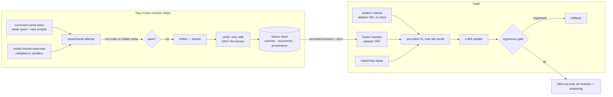

# nightshift

**A model that learns on the job by day and consolidates what it learned into its weights by night.**

A language model is handed `tessel`, a Python library invented for this repo, so no model has seen
it in training. A new module ships every day for 10 days. Each day the model:

1. **works**: attempts tasks that need the new API, closed-book, and gets graded by *running its code*;
2. **reflects**: when it fails, it writes itself a one-line lesson, then proves the lesson works by
   retrying the task with only that lesson in context;
3. **practices**: picks its own weak spots and invents new exercises for itself, which are only
   accepted if its own reference solution runs and a do-nothing stub fails;

and each night it:

4. **consolidates**: distills docs + its verified lessons into a LoRA adapter with on-policy
   self-distillation, then must pass a regression gate (general reasoning + older modules)
   or the update is rolled back.

The question: **by day 10, can it use the whole library with zero docs in the prompt, without
forgetting the early modules or getting worse at general reasoning?**

The headline metric is accuracy on **unseen task types**: for every module, one kind of task is
never practiced, never used by the gate, and never trained on. It only appears in the final eval,
so passing it means the model learned the API, not the prompt.

> **Status: the pipeline is built and tested; there are no real results yet.** The numbers in
> `demo/run_artifacts.json` come from a scripted stub and are labeled as such everywhere. Real
> numbers require one GPU run (`scripts/run_cloud.sh`).

## The four arms

All arms start from the same weights, get the same daily releases and are scored on the same
held-out eval. (Half of each day's practice is weakness-weighted, so it adapts per arm.)

| arm | memory at test time | learns by | what it shows |
|---|---|---|---|
| `base` | none | nothing | the floor: what the model can guess |
| `rag` | docs + lessons in every prompt | nothing (in-context only) | the ceiling for "just give it the docs"; prompt grows daily |
| `sft` | **none** | nightly fine-tuning on the teacher's verified solutions | off-policy imitation (known to forget) |
| `sdft` | **none** | nightly on-policy self-distillation + reasoning replay | the method under test |

The **teacher** for both `sft` and `sdft` is identical: the frozen initial weights (LoRA switched
off) with docs + promoted lessons in context. So `sft` vs `sdft` isolates the learning method.

A win looks like: `sdft` ≈ `rag` on unseen-type accuracy with **0 memory tokens**, `sdft` > `sft` on
earlier-module retention, and `sdft` ≈ `base` on general reasoning.

## How it works



**The loss** (`nightshift/losses.py`): at every position of the student's own sampled completion,
minimize KL between the student's and teacher's *full next-token distributions* (forward KL by
default, `--kl-direction reverse` available). The student and teacher prompts have different
lengths; `completion_logits` aligns them token for token. The tempting shortcut
`(s_logp - t_logp).mean()` on sampled tokens is wrong: with a frozen teacher its gradient doesn't
depend on the teacher at all. There's a test proving that (`tests/test_losses.py`).

**Why the result would be trustworthy:**
- `tessel` is invented, with unusual names (`Run.knot(fn, seed=)` not `reduce`), so the base model can't just guess. (Some task prompts use the module's verbs, e.g. "seal", so prompts carry a little API signal; the `base` arm measures how much.)
- One task type per module is held out entirely; the headline number is measured only on those.
- Every task is graded by executing code against hidden tests. No LLM judge anywhere.
- Eval, gate and practice instances of practiced task types come from disjoint seed ranges, and self-made exercises identical to an eval prompt are rejected (tested).
- Reference solutions never appear in any prompt (tested).
- Every eval prompt and output is saved; the demo shows the exact prompt for each arm.
- The `base` arm is the floor; the `rag` arm is the ceiling.

More detail and the open risks: [`docs/DESIGN.md`](docs/DESIGN.md). Related work: [`docs/RESEARCH.md`](docs/RESEARCH.md).

## Run it

**Laptop (no GPU), proves the pipeline:**

```bash
python3 -m venv .venv && . .venv/bin/activate && pip install -r requirements.txt
python -m pytest -q                                          # 25 tests, ~30s
python -m nightshift.run --engine stub --out-dir runs/dry    # full 10 days, scripted model, ~2 min
python -m nightshift.run --engine tiny --days 2 --practice-per-day 4 --max-new-tokens 24 --out-dir runs/tiny
```

`stub` is a scripted fake model that exercises every code path (lessons, promotion, authored tasks,
gate, artifacts). `tiny` is a real 2-layer random transformer that runs the actual training code
(rollouts, KL, LoRA, rollback). **Neither produces meaningful results.**

**Real run (one 80 GB GPU, A100/H100):**

```bash
gh auth login                                   # the repo is private
gh repo clone samisbakedham/nightshift && cd nightshift
bash scripts/run_cloud.sh                       # tests → stub dry run → 1-day real preflight → full run
bash scripts/run_cloud.sh --days 3 --arms base,rag,sdft   # cheaper first look
```

Runtime and cost are **not measured yet**. A rough estimate for the full run is several hours of
generation-bound work (≈ 4–8 h, so roughly $5–20 at current A100 rental prices). Do a `--days 3` run first.
Use a 7B+ model: self-distillation relies on the model using docs in context well, which
small models do poorly.

Artifacts are rewritten after every simulated day, so a crash loses at most one day.
Outputs: `runs/<timestamp>/run_artifacts.json` (metrics + showcase traces), `traces.jsonl` (every
prompt and output), and LoRA adapters for days 1, 5 and 10.

## Demo page

`demo/` is a static page (no build step) that reads `demo/run_artifacts.json`:
scoreboard, six charts over the 10 days, a day slider, a side-by-side of all four arms on the same
held-out task with a raw-prompt inspector, the lessons the model wrote, and the nightly gate log.
It shows a red **DRY-RUN PLACEHOLDER** banner whenever the artifacts didn't come from a real model.

```bash
python3 -m http.server 4317 --directory demo     # open http://localhost:4317
npx vercel deploy demo                            # or drag the demo/ folder into Vercel
```

## Repo map

```
nightshift/
  env/tessel_lib/tessel/   the invented library (10 modules)
  env/releases.py          release schedule, docs, 30 task templates with reference solutions
  env/tasks.py             task instances + disjoint eval / gate / practice splits
  env/sandbox.py           runs model code in a subprocess with timeout + rlimits
  env/reasoning.py         generated general-reasoning set (eval + replay)
  prompts.py               every prompt, in one place
  lessons.py               reflect → verify → score → promote, with provenance
  curriculum.py            weakness-weighted practice + self-authored task validation
  losses.py                full-vocab token KL + alignment
  policy.py                Policy interface + scripted StubPolicy
  hf_policy.py             HF model + LoRA; teacher = adapter disabled
  experiment.py            the day/night loop, gate, metrics, artifacts
  run.py                   CLI
scripts/run_cloud.sh       one-command GPU run
demo/                      static demo page
tests/                     25 tests
```

## Swapping the environment

Everything domain-specific is in `nightshift/env/`. To teach the model something else, keep the
same `Task` shape (prompt, hidden tests, reference solution) and a release schedule; the lesson,
curriculum, training and demo layers don't care what the tasks are about.
